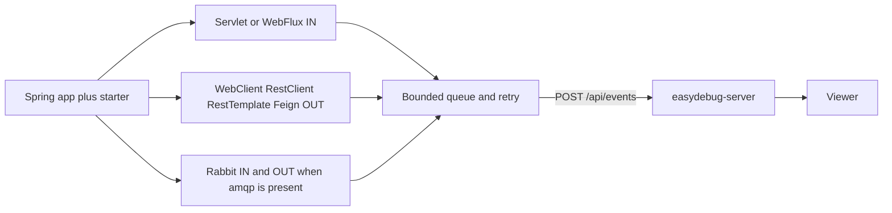

# Architecture

## Starter

`EasyDebugAutoConfiguration` loads only when `easydebug.url` is non-blank. It builds a `CapturePolicy`, a JDK `HttpClient` poster, and an `EventSender`. The poster is the JDK client on purpose: the Spring hooks must not record the ingest call a second time. URLs that start with the collector URL are also excluded, and that exclusion is written on the policy event.

On `ApplicationReadyEvent` the starter submits one `capture.policy` event and logs the same facts: which hooks installed, which were skipped because the library is absent, the exclude lists, the redaction lists, and the body cap.

Each hook is its own auto-configuration, loaded only when the library is on the classpath:

- `EasyDebugServletAutoConfiguration` registers one filter at the highest precedence.
- `EasyDebugWebFluxAutoConfiguration` registers one `WebFilter` when the application type is reactive.
- `EasyDebugWebClientAutoConfiguration` adds an `ExchangeFilterFunction` through `WebClientCustomizer`, and the same filter to any `WebClient` bean.
- `EasyDebugRestClientAutoConfiguration` adds a `ClientHttpRequestInterceptor` through `RestClientCustomizer`, and the same interceptor to any `RestClient` bean.
- `EasyDebugRestTemplateAutoConfiguration` adds the same interceptor through `RestTemplateCustomizer`, and to any `RestTemplate` bean.
- `EasyDebugFeignAutoConfiguration` wraps every `feign.Client` bean when Feign is on the classpath.
- `EasyDebugRabbitAutoConfiguration` adds a publish post-processor and a listener advice.

A client built from the Boot builder is recorded once. A bean that was not built that way is recorded by the post-processor. The post-processor sees an interceptor or filter that is already there and leaves it, so the two paths do not write two rows for one call. A chain of Feign client beans shares the request object, and only the outer wrapper records it.

`submit` never blocks and never throws. The business call does not wait for the collector and does not fail because the collector is down.

## Sender

The sender thread drains a bounded queue in batches of up to 100 and POSTs a JSON array to `{url}/api/events`.

- `2xx` accepts the batch.
- `5xx` and I/O errors retry with backoff capped at 30 seconds, for as long as the process is up.
- `4xx` is not retried. Those events are counted, and the next successful batch starts with a `capture.gap` event.
- `queue.offer` failing means the call was not queued. It is counted the same way.

A gap event says how many calls, from when, until when. It does not contain the missing bodies. That is the honest signal that delivery fell behind. On shutdown the sender tries once more to flush, then logs whatever is still undelivered.

Client-generated ids make ingest idempotent, so a retry does not create a second row.

## Server

`POST /api/events` accepts one JSON object, a JSON array, or `{"events":[...]}`. Each object is stored whole. Missing `id`, `kind`, or `occurredAt` are filled so a partial event is still stored. When `host` is absent it is derived from the URL and written onto the stored JSON.

Rows live in H2. The default file is `./data/easydebug`. `GET /api/events` returns matching rows newest first. Filters only narrow a query the caller asked for. There is no partner predicate.

The viewer at `/` is a static page. The list asks for `view=summary`, which omits the two body strings in that response only. `GET /api/events/{id}` returns the stored JSON with every field. `GET /api/policy` returns the latest policy event.

## Demo

`easydebug-demo` is a servlet app. `GET /demo/outbound` uses an injected `WebClient.Builder` to call `GET /demo/downstream` on itself. `GET /demo/boom` throws, so the inbound filter records the failure. Capture follows `EASYDEBUG_URL`. With that variable empty, the demo still serves and capture stays off.
